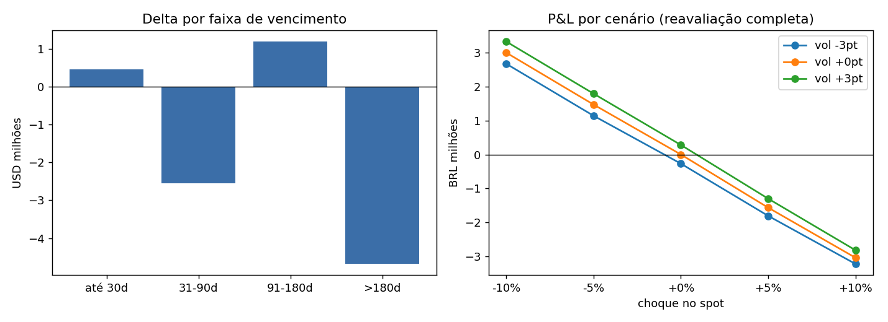

# Exposição de Derivativos (USD/BRL)

Relatório de risco para uma carteira de **opções de câmbio**: calcula **Delta, Gamma e Vega** por posição, consolida por faixa de vencimento, simula **P&L por cenário** (reavaliação completa) e verifica o uso de **limites**.

> ⚠️ Projeto de estudo. A carteira, as taxas e os limites são **fictícios/ilustrativos** e não representam dados, sistemas ou código de nenhuma instituição.



## O que ele faz

- Precifica opções europeias com o modelo **Garman-Kohlhagen** (Black-Scholes para câmbio), sem depender de SciPy.
- Converte as gregas em exposições comparáveis: Delta em USD, Gamma como variação do Delta para +1% no spot, Vega em BRL por +1 ponto de volatilidade.
- Agrupa por faixa de vencimento (até 30d, 31-90d, 91-180d, >180d).
- Reavalia a carteira inteira em choques de spot (±10%) e de volatilidade (±3 pontos).
- Compara as exposições com `limits.json` e classifica em `OK`, `ATENÇÃO` (≥ 80% do limite) ou `ESTOURO`.

## Como rodar

```bash
git clone https://github.com/Joaopedro2612/derivatives-exposure.git
cd derivatives-exposure
pip install -r requirements.txt

python generate_portfolio.py      # (opcional) recria a carteira fictícia
python exposure.py                # gera o relatório em outputs/
python -m unittest discover -s tests
```

Para usar sua própria carteira, aponte `--input` para um CSV com as colunas
`trade_id, kind (call|put), strike, days_to_maturity, vol, quantity_usd` (positivo = comprado, negativo = vendido).
Spot e taxas são parâmetros: `python exposure.py --spot 5.40 --r-dom 0.13 --r-for 0.045`.

## Metodologia e convenções

| Item | Convenção |
|---|---|
| Prazo | dias corridos / 365 |
| Taxas | contínuas, curva plana (BRL doméstica, USD estrangeira) |
| Delta | `delta × principal em USD` |
| Gamma | `gamma × (1% × spot) × principal`, ou seja, variação do Delta em USD para +1% no spot |
| Vega | `vega × 0,01 × principal`, em BRL por +1 ponto de vol |
| Cenários | reavaliação completa (não aproximação por gregas) |

Os testes verificam paridade put-call, relação entre Deltas e Delta contra diferença finita.

## Limitações e próximos passos

- Curva de juros plana e volatilidade única por opção (sem smile).
- Sem calendário de dias úteis e sem opções exóticas.
- Ideias: dashboard em Streamlit, curvas reais como entrada, VaR por simulação histórica.

## Licença

MIT
